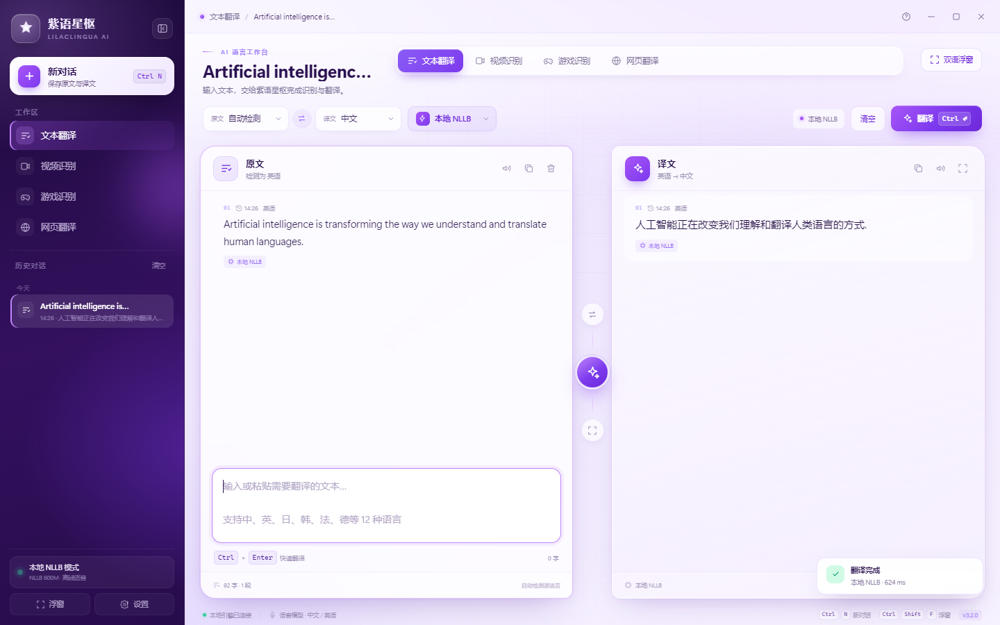
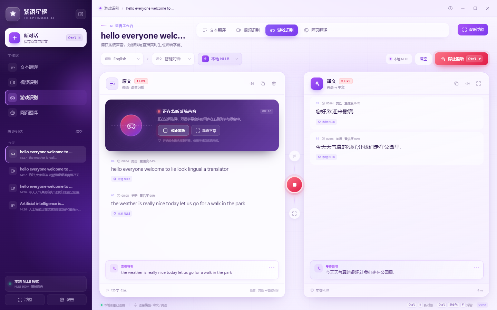
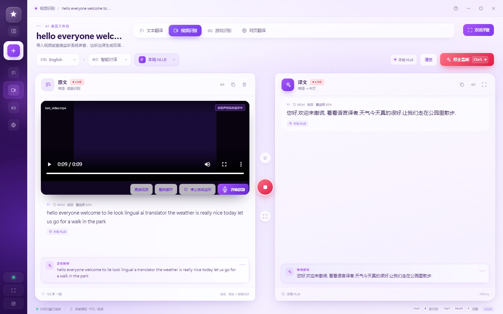
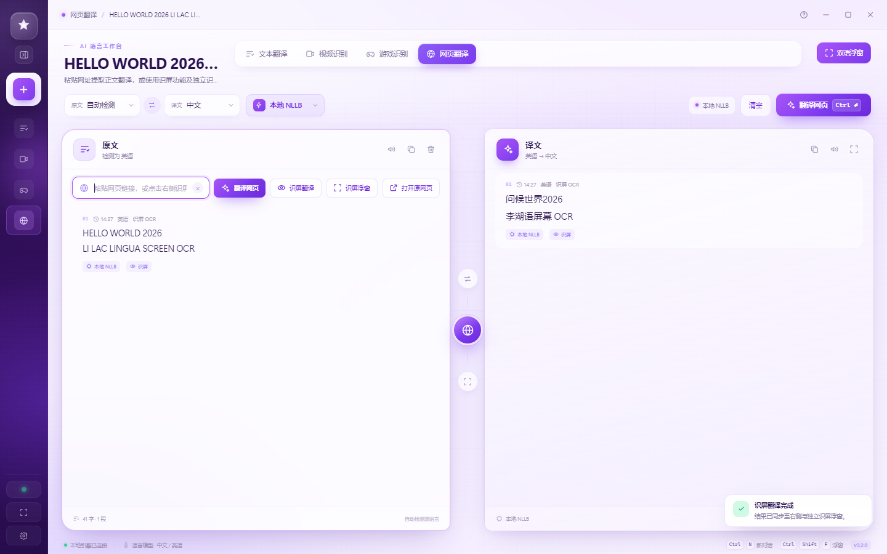
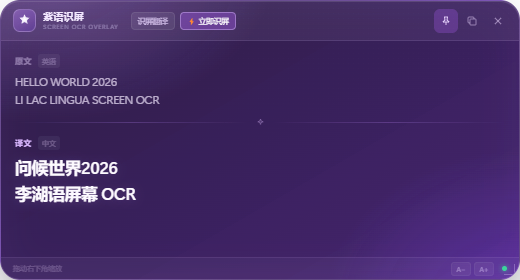
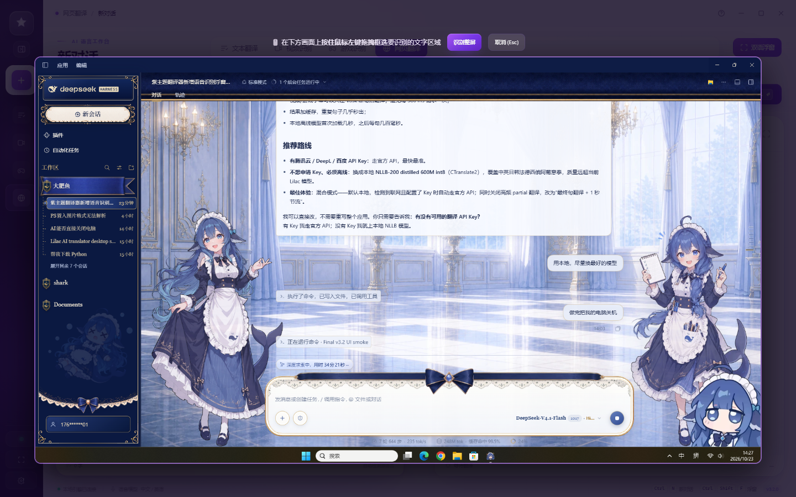
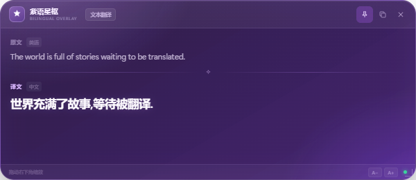
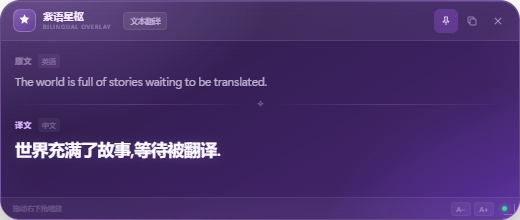

# 紫语星枢 · LilacLingua AI v3.2

> 一个以紫色为主视觉的桌面语言工作台：**本地 NLLB 神经翻译 + 本地语音识别 + 网页与识屏翻译 + 可拖动缩放的双语浮窗**。





在原有的 LilacLingua 多语种识别 / 翻译模型基础上，本版本完成了工作台 UI 重构，并新增视频语音识别、游戏语音识别、视频系统声音监听、网页正文翻译、识屏翻译与独立浮窗。v3.2 将原来质量有限的本地 Lilac 翻译模型替换为 **NLLB-200 distilled 600M（CTranslate2 int8）**，默认完全离线，12 种语言互译；同时保留在线增强作为可选后备。应用自带 Electron 运行时、嵌入式 Python 运行时、Vosk 中英文声学模型与 NLLB 模型，**双击即可启动，无需安装 Python / Node.js，也无需联网翻译**。

### v3.2 本地翻译升级
- 默认翻译引擎改为 **NLLB-200 distilled 600M**，覆盖中、英、日、韩、法、德、西、俄、阿、葡、意、泰。
- 采用 **CTranslate2 int8** 量化，i5-12400F 实测单句约 **0.3–0.7 秒**，批量网页翻译明显更快。
- 首次启动后台加载模型约 1–2 秒；之后常驻内存，不再走网络。
- 实时字幕只在 Vosk 断句后翻译，避免高频 partial 请求拖慢本地模型。
- 在线增强仍可在顶部模式中切换；在线失败时也会回退到本地 NLLB，而不是旧 Lilac 模型。

### v3.1 重点修复
- 移除实时识别中的“强制提前断句”，避免英文对话被切成 `she your job`、`mark` 之类的碎片；恢复 Vosk 自然断句。
- 修复识屏截图包含本应用窗口的问题；框选裁剪坐标越界时自动收敛。
- 修复停止识别后 partial 翻译状态导致的卡顿。
- 修复 1080×720 窄屏下网页工具栏把地址栏挤到不可用的问题（地址栏独占一行，按钮换行）。
- 恢复完整的 Electron 冒烟测试，并补充视频系统声音、识屏、识屏浮窗、窄屏布局验证。

---

## 一、启动方式

推荐双击项目根目录的 **`紫语星枢.exe`**，或桌面上的 **“紫语星枢”** 快捷方式。

- 启动器为无黑框窗口程序，带紫色水晶语音图标。
- 首次启动约 3–6 秒（窗口先出现，随后载入 Vosk 与 NLLB 模型）。
- 备用启动方式：`启动紫语星枢.bat`、`启动紫语星枢.vbs`。
- 关闭主窗口会隐藏到系统托盘；双击托盘图标或从托盘菜单可重新打开。完全退出请使用托盘菜单或“设置 → 退出应用”。

> 代码结构仍然是可调试的 Electron + Python 项目，`npm start` 也可以直接启动（需已安装依赖）。

---

## 二、界面说明

### 1. 左侧工作区（约占 1/5，可收起）
- **新对话**：把当前对话的原文与译文保存到历史，并开始新的一段。
- **工作区**：文本翻译 / 视频识别 / 游戏识别 / 网页翻译快速切换。
- **历史对话**：按“今天 / 昨天 / 日期”分组，点击即可恢复当时的原文、译文、视频字幕或网页译文。
- **状态卡**：显示本地引擎、语音模型和在线/离线模式。
- 点击顶部图标可收起为窄栏，再次点击展开；收起状态会被记住。

### 2. 顶部功能区
- 四个功能页签：**文本翻译、视频识别、游戏识别、网页翻译**。
- 语言选择：原文语言（自动检测或手动指定）、译文语言、互换按钮。
- 模式选择：**本地 NLLB（默认，完全离线）** 或 **在线增强**（腾讯神经翻译，失败时回退 MyMemory / 本地 NLLB）。
- 语音模式额外提供“识别语言”：**中文普通话 / English**，以及“智能对译”目标（按识别到的语言自动译为另一种常见语言）。
- 右侧为当前功能的主动作按钮（翻译 / 开始识别 / 开始监听 / 翻译网页）。

### 3. 原文 / 译文双卡片
- 左侧卡片显示原文、视频预览、游戏监听状态或网页原文。
- 右侧卡片显示译文、网页译文或逐句字幕。
- 每条原文和译文都会保留在当前对话中；鼠标悬停可以联动高亮对应的原文 / 译文。
- 支持复制、朗读、清空当前对话。

---

## 三、新增功能

### 1. 视频语音识别
- 点击“选择视频”，或直接把视频拖进窗口。
- 支持 MP4 / MOV / MKV / WebM / AVI 等常见格式。
- **实时模式**：播放视频时点击“开始识别”，捕获视频音轨并流式送入离线 Vosk 识别，字幕逐句翻译。
- **视频系统声音监听**：点击“监听系统声音”，直接捕获电脑上正在播放的视频声音（浏览器、播放器、直播等），无需先导入文件。
- **整段解析**：点击“整段解析”，由内置 ffmpeg 抽取音轨后一次性识别、断句、翻译，适合长视频或浏览器无法解码的格式。
- 识别语言请在顶部选择（中文 / English）。
- 支持**边听边译**：右侧会先显示不断更新的实时译文，最终在 Vosk 完成断句后固化为正式字幕。



### 2. 游戏语音识别（系统音频回环）
- 切换“游戏识别”，选择游戏语音语言，点击“开始监听”。
- Windows 会请求共享屏幕；**只是用它来取得系统音频回环**，应用不会上传或保存屏幕画面。
- 游戏里的对白会被实时识别，并在右侧和浮窗中同步显示原文 / 译文。
- 支持中英文模型；请选择游戏实际使用的语音语言以获得最佳效果。
- 如果使用耳机，回环捕获的是系统输出流，不影响正常听声。

### 3. 网页翻译
- 在“网页翻译”中粘贴网址（支持直接输入域名）。
- 自动抓取网页正文，提取标题、段落、列表与标题层级。
- 左卡显示网页原文，右卡显示完整译文；右侧译文默认附带原文对照，可选择“打开原网页”。
- 网页原文与译文会随当前对话一起保存。

### 4. 识屏翻译（OCR）与识屏浮窗
- 在“网页翻译”工作区点击“识屏翻译”，主窗口会暂时隐藏并抓取屏幕，随后在预览画面上拖拽框选文字区域，或点击“识别整屏”。
- 使用 Windows 10/11 内置 OCR 引擎识别文字（本机执行），再把文字交给翻译引擎。
- 识别结果会加入当前对话，并自动打开**识屏浮窗**；浮窗上也有“⚡ 立即识屏”按钮，适合放在游戏 / 视频 / 直播画面上。
- 识屏浮窗可独立拖动、缩放、置顶，关闭后不影响主窗口。
- 屏幕截图只用于本机 OCR，不会上传；只有“在线增强”模式下的纯文本会发送到在线翻译服务。







### 5. 双语浮窗
- 点击顶部或卡片右上角的“双语浮窗”按钮打开。
- 浮窗显示**原文 + 译文**，适合放在游戏 / 视频画面上。
- 拖动顶部移动，拖动右下角缩放；位置和尺寸自动记忆。
- 支持置顶、字号缩放、复制译文、朗读，以及半透明显示。
- 游戏监听开始时会自动打开浮窗（可在设置里调整置顶/透明度/字号）。





### 6. 其他体验
- 紫色渐变 + 玻璃拟态卡片 + 光晕星轨空状态。
- 应用图标为紫色水晶语音气泡（`assets/icon.ico` / `icon.png`），启动器和桌面快捷方式均使用该图标。
- 全局快捷键：`Ctrl+N` 新对话，`Ctrl+Enter` 翻译，`Ctrl+Shift+F` 浮窗，`Esc` 关闭弹窗。
- 所有原文、译文、字幕、网页译文保存在本机 `%APPDATA%\lilaclingua-ai-desktop\history.json`。

---

## 四、目录结构

```
LilacLingua_AI/
├─ 紫语星枢.exe                  # 无黑框启动器（带图标）
├─ 启动紫语星枢.bat / .vbs       # 备用启动脚本
├─ 紫语星枢.lnk                  # 项目内快捷方式
├─ electron/
│  ├─ main.js                    # 主进程：窗口、托盘、浮窗、后端启动、IPC
│  └─ preload.js                 # 安全 IPC 桥
├─ ui/
│  ├─ index.html / styles.css / app.js
│  ├─ float.html / float.css / float.js
│  └─ splash.html
├─ backend/
│  ├─ server.py                  # 本地 HTTP 服务 + 静态页面 + /media Range
│  ├─ translator.py              # 在线 / 离线翻译网关与缓存
│  ├─ nllb_translator.py         # NLLB-200 600M + CTranslate2 本地引擎
│  ├─ asr_service.py             # Vosk 流式识别、文件识别、断句
│  ├─ web_reader.py              # 网页正文提取与整页翻译
│  └─ languages.py
├─ model/                        # 原有 LilacLingua 模型与权重
├─ models/                       # Vosk 中英文模型 + NLLB-200 600M CT2 模型
├─ runtime/python/               # 嵌入式 Python 3.12 运行时（含 CTranslate2）
├─ assets/                       # 图标
├─ tests/                        # 后端 + Electron 自动化验证
└─ dist/                         # 可选打包输出
```

---

## 五、技术架构

- **桌面壳**：Electron 31，无边框自绘标题栏，`contextIsolation` + 窄 IPC 桥，`webview` 不启用。
- **本地服务**：Python 标准库 `ThreadingHTTPServer`，只监听 `127.0.0.1`，端口由主进程动态分配。
- **翻译**：
  - 本地 NLLB（默认）：`NLLB-200 distilled 600M` + CTranslate2 int8，单句约 0.3–0.7 秒，12 种语言，完全离线。
  - 在线增强：腾讯 Transmart 公共神经翻译接口（批量、自动检测），失败时回退 MyMemory，再回退本地 NLLB。
  - 旧 `LilacLinguaModel` 保留作语言检测与极端情况回退。
  - 结果按 `(source,target,mode,text)` 写入 SQLite 缓存，重复内容秒出。
- **语音识别**：Vosk 小型中英文声学模型；16 kHz PCM16 单声道流式输入；按词时间戳断句；系统音频回环或视频音轨通过 WebAudio 重采样后送入；本地模式只在断句后翻译，在线模式可显示 partial 预览。
- **视频**：`<video>` 元素 + `captureStream()` 获取音轨；整段解析走内置 ffmpeg → 16 kHz WAV → Vosk。
- **网页**：`urllib` 抓取 + `HTMLParser` 正文块提取；标题与段落批量翻译。
- **识屏**：`desktopCapturer` 抓屏 + 自绘框选预览 → 本地 Canvas 裁剪 → Windows.Media.Ocr（PowerShell/WinRT）识别 → 文本翻译。
- **浮窗**：双语字幕浮窗与识屏浮窗各为独立 `BrowserWindow`，始终置顶、无边框、可缩放，位置/尺寸/透明度/字号持久化。
- **数据**：历史与设置保存在 Electron `userData`；翻译缓存与本地模型数据在 `userData/data`。

> 语音识别、网页抓取、屏幕 OCR 和本地 NLLB 翻译都在本机执行。只有“在线增强”会把纯文本发送到在线翻译服务；默认的“本地 NLLB”完全不出网。

---

## 六、开发与验证

```powershell
# 安装依赖（仅开发需要）
npm install

# 启动
npm start

# 后端端到端测试：NLLB 本地翻译、在线翻译、流式 ASR、视频任务、网页、OCR、Range
npm run test:backend

# Electron UI 冒烟测试：截图 + 历史恢复 + 视频/游戏/系统音频/OCR/浮窗
npm run test:ui
```

`tests/ui_smoke.js` 会自动启动本地网页 fixture；实际冒烟测试在 `electron/main.js` 中通过 `--smoke=<目录>` 触发，会生成：

- 文本、视频、游戏、网页四个工作区截图
- 文本翻译结果（默认走本地 NLLB）、历史恢复
- 视频整段解析 + 视频实时字幕 + 视频系统声音监听
- 游戏系统回环捕获（会播放一段测试语音）
- 识屏框选预览、OCR 翻译结果、识屏浮窗
- 双语浮窗 + 浮窗缩放 + 侧边栏收起 + 1080×720 窄屏布局截图

测试用语音由 Windows SAPI 生成，测试视频/识屏图由 ffmpeg 与 Pillow 合成，不包含任何用户数据。

---

## 七、常见问题

**Q：视频没有声音 / 识别不到？**
- 确认视频本身有音轨；部分编码浏览器无法解码时，直接用“整段解析”。
- 识别语言要与视频语音一致（中文 / English）。

**Q：游戏识别没有字幕？**
- 开始监听时请允许屏幕共享；Windows 需要选择“整个屏幕”才能拿到系统音频。
- 确认游戏声音从默认输出设备播放；如果切到其他声卡，可能需要在 Windows 声音设置中调整默认设备。
- 识别语言请手动选择，自动检测不作为默认项（中英文声学模型对非对应语言容易产生误识别）。

**Q：识屏翻译没有识别到文字？**
- 框选区域要包含清晰文字；尽量避开动画、渐变背景和过小字号。
- 识屏使用 Windows 内置 OCR，未安装对应语言包时可能识别失败；可在 Windows 设置中安装中文/英文 OCR 语言包。
- 识屏浮窗的“立即识屏”默认抓取整屏，建议先把要识别的内容放在前台。

**Q：本地 NLLB 翻译为什么第一次慢一点？**
- 首次启动会在后台加载约 622 MB 的 int8 模型，通常 1–2 秒；加载完成后常驻内存，单句约 0.3–0.7 秒。
- 如果机器内存较小或同时运行大程序，加载和推理会变慢；可切到“在线增强”减轻本地压力。
- 模型文件在 `models/nllb-200-distilled-600M-ct2-int8`，不要删除；模型约 622 MB。

**Q：本地 NLLB 的准确度还能再提高吗？**
- 可以换成 `NLLB-200 distilled 1.3B`（约 1.4 GB），质量更好，但 CPU 单句会慢约 2 倍；当前 600M 是实时字幕的速度/质量平衡点。
- 也可以在“本地 NLLB / 在线增强”之间切换；在线增强使用腾讯神经翻译，质量通常更高，但需要联网。

**Q：在线翻译失败？**
- 检查网络；应用会自动回退 MyMemory / 本地 NLLB。
- 需要隐私或离线时，请在顶部模式选择“本地 NLLB”，翻译完全不出网。

**Q：打开应用提示“未找到 Electron 运行环境”？**
- 请保持 `node_modules` 文件夹与 `紫语星枢.exe` 同级，不要只复制 exe。

**Q：历史记录在哪儿？**
- `%APPDATA%\lilaclingua-ai-desktop\history.json`；设置在同目录 `settings.json`。
- 可在“设置 → 打开数据目录”直接打开。

---

## 八、致谢

- 原始 LilacLingua 语言识别 / 翻译模型与界面由项目作者提供。
- 本地神经翻译使用 [NLLB-200](https://huggingface.co/facebook/nllb-200-distilled-600M)（CC-BY-NC 4.0）与 [CTranslate2](https://github.com/OpenNMT/CTranslate2)；模型仅用于非商业本地翻译。
- 语音识别使用 [Vosk](https://alphacephei.com/vosk/) 离线声学模型。
- 在线翻译使用腾讯 Transmart 公共接口与 MyMemory 作为回退；离线模式使用项目自带模型。
- 图标、界面与桌面封装为本版本新增。
